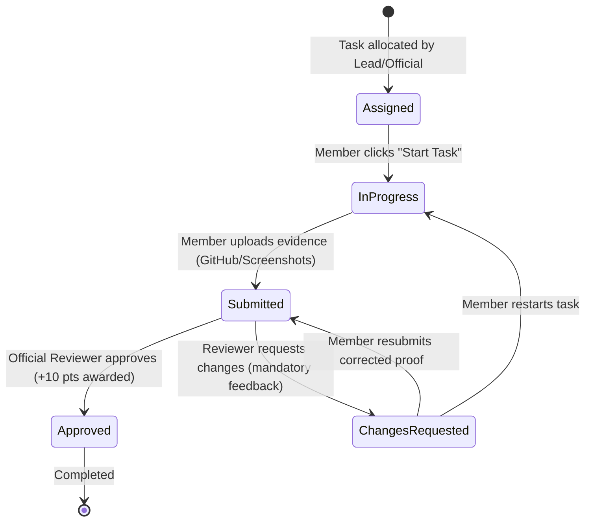

# TechNeekX Community Reporting & Task Management System

A role-based community task allocation, evidence submission, peer review, idempotent scoring, live leaderboard, announcements, and audit logging platform built with Django REST Framework, PostgreSQL, and a modern React 19 / TypeScript frontend.

---

## 🌟 System Overview & MVP Scope

TechNeekX Community Reporting System provides a transparent, auditable platform for managing structured deliverables across hierarchical community teams:

1. **Role-Based Identity & Security (SimpleJWT)**:
   - Full 12-role community hierarchy organized into 5 strict authorization tiers.
   - Public registration defaults safely to `Member` (Tier 5); privilege escalation attempts are strictly rejected.
   - JWT tokens (`access` and `refresh`) with silent automatic renewal on token expiry.
2. **Hierarchical Teams & Groups**:
   - Parent-team and sub-team relationships with specialized working groups.
   - Lead authorization required to assign or remove members.
3. **Structured Task Workflow State Machine**:
   - Explicit dual assignment: individual community member, entire team, or both (with membership validation).
   - Validated status transitions:
     - `Assigned` → `In Progress` → `Submitted` → `Approved` (completes task, awards +10 pts).
     - `Submitted` → `Changes Requested` (requires mandatory feedback) → `Submitted` (corrected proof).
   - Arbitrary client-side status shifts and invalid state reversions are strictly rejected.
4. **Verifiable Deliverable Proofs & Anti-Self-Review**:
   - Proof submissions support GitHub pull request URLs, screenshot links, and technical implementation notes.
   - **Anti-Self-Review Enforced**: Submitting members and assigned users are strictly forbidden from reviewing their own work (HTTP 403 Forbidden).
5. **Transactional Idempotent Scoring (+10 Pts)**:
   - Exactly 10 points awarded per approved task to the submitter.
   - Row-level database locks (`select_for_update()`) and approval record guards prevent duplicate points even under concurrent requests.
6. **Live Community Leaderboard**:
   - Real-time performance standings sorted by points descending, completed task counts, and rank badges.
7. **Official Announcements & Immutable Audit History**:
   - Authorized leads broadcast community bulletins.
   - All state shifts, reviews, logins, and point grants are recorded in `history_logs`.

---

## 🏗️ Architecture & Repository Structure

```
TECHNEEKX REPORTING SYSTEM/
├── .env.example                               # Safe configuration template (committed)
├── .env                                       # Local environment settings (gitignored)
├── .gitignore                                 # Git protection for secrets, DBs, and builds
├── README.md                                  # Complete system documentation
├── database/
│   └── techneekx_reporting_schema_seed.sql    # Reviewed baseline PostgreSQL schema & seed data
├── docs/
│   ├── architecture.md                        # Architectural specification & RBAC rules
│   ├── audit_phase1.md                        # Initial codebase audit report
│   ├── database_integration.md                # PostgreSQL mapping & migration strategy
│   ├── frontend_foundation.md                 # UI design tokens & component system
│   └── frontend_api_integration.md            # Feature-to-endpoint mappings & workflows
├── backend/                                   # Django REST Framework Backend
│   ├── manage.py                              # Django management CLI
│   ├── requirements.txt                       # Python dependencies
│   ├── config/                                # Core project settings, URLs, and WSGI/ASGI
│   │   ├── settings.py                        # DB, JWT, CORS, and DRF configuration
│   │   └── urls.py                            # Root API route router
│   ├── apps/                                  # Modular domain applications
│   │   ├── accounts/                          # Custom User model, roles, JWT auth, and RBAC
│   │   ├── teams/                             # Teams, Groups, and membership management
│   │   ├── tasks/                             # Task CRUD, assignments, and lifecycle state machine
│   │   ├── submissions/                       # Proof evidence, reviews, and anti-self-review
│   │   ├── scoring/                           # Transactional points engine and live leaderboard
│   │   ├── announcements/                     # Community announcements API
│   │   └── activity/                          # Immutable audit logs and event tracker
│   └── tests/                                 # Automated Django unit and integration tests
└── frontend/                                  # React 19 + TypeScript + Vite Application
    ├── package.json                           # Node dependencies and scripts
    ├── vite.config.ts                         # Vite bundler configuration
    ├── scripts/
    │   └── test-frontend.mjs                  # Native integration test runner (Node 24)
    └── src/
        ├── types/api.ts                       # Typed TypeScript models and DTOs
        ├── services/api.ts                    # Axios/Fetch client with JWT auto-refresh
        ├── context/AuthContext.tsx            # Global auth state and demo persona switcher
        ├── styles/tokens.css                  # Violet SaaS design token custom properties
        ├── components/
        │   ├── ui/                            # 13 reusable accessible component primitives
        │   └── layout/                        # Sidebar, TopBar, and responsive AppShell
        └── views/                             # Dashboard, Tasks, Leaderboard, Teams, etc.
```

---

## ⚙️ Environment Configuration

Copy `.env.example` to create your local `.env`:
```powershell
Copy-Item .env.example .env
```

| Variable Name | Default / Example Value | Description |
| :--- | :--- | :--- |
| `SECRET_KEY` | `django-insecure-random-key` | Django cryptographic signing key |
| `DEBUG` | `True` (dev) / `False` (prod) | Debug error display mode |
| `ALLOWED_HOSTS` | `localhost,127.0.0.1` | Whitelisted HTTP host headers |
| `DB_NAME` | `techneekx_db` | PostgreSQL database name |
| `DB_USER` | `postgres` | PostgreSQL username |
| `DB_PASSWORD` | `your_postgres_password` | PostgreSQL password |
| `DB_HOST` | `localhost` | PostgreSQL host |
| `DB_PORT` | `5432` | PostgreSQL port |
| `JWT_ACCESS_TOKEN_LIFETIME_MINUTES` | `60` | JWT access token lifespan |
| `JWT_REFRESH_TOKEN_LIFETIME_DAYS` | `7` | JWT refresh token lifespan |
| `CORS_ALLOWED_ORIGINS` | `http://localhost:5173,http://127.0.0.1:5173` | Allowed frontend origins |
| `VITE_API_BASE_URL` | `http://127.0.0.1:8000/api` | Base URL for frontend API client |

> [!CAUTION]
> Never commit actual passwords, private keys, or `.env` files to source control. `.env` is strictly protected in `.gitignore`.

---

## 🗄️ PostgreSQL Setup & Migration Sequence

### 1. Database Creation
In PostgreSQL (pgAdmin or `psql`):
```sql
CREATE DATABASE techneekx_db;
```

### 2. Apply Reviewed Schema & Seed Data
Execute the approved baseline SQL file:
```powershell
psql -U postgres -d techneekx_db -f database/techneekx_reporting_schema_seed.sql
```

### 3. Synchronize Django Migrations
Establish Django ORM synchronization using fake-initial baselines:
```powershell
python backend\manage.py migrate --fake-initial
```

### 4. Initialize Seed Passwords
Hash placeholder seed passwords to activate the demo accounts (`Techneekx@2026`):
```powershell
python backend\manage.py seed_passwords --password Techneekx@2026
```

---

## 🚀 Running the System Locally

### Backend (Django)
```powershell
# 1. Install dependencies
pip install -r backend\requirements.txt

# 2. Run system checks
python backend\manage.py check

# 3. Start development server
python backend\manage.py runserver 127.0.0.1:8000
```

### Frontend (Vite + React)
```powershell
# 1. Install dependencies
npm --prefix frontend install

# 2. Start development server
npm --prefix frontend run dev
```
Open `http://localhost:5173/` in your browser.

---

## 🧪 Running Automated Tests

### 1. Backend Django Test Suite (20 Tests)
Exercises authentication, registration privilege escalation prevention, permissions matrix, task lifecycle state machine, anti-self-review guards, and idempotent scoring:
```powershell
python backend\manage.py test tests
```
*Result: 20 passed (0 failures, 0 errors, 0 silenced).*

### 2. Frontend Integration & Boundary Test Suite (20 Tests)
Exercises authentic JWT token retrieval, API security boundaries, correction-resubmission cycles, duplicate review prevention, leaderboard updates, and audit trail records against the live backend:
```powershell
npm --prefix frontend test
```
*Result: 20 passed (0 failures, 0 skipped).*

### 3. Frontend Static Analysis & Type Checking
```powershell
# Oxlint static analysis (0 warnings, 0 errors)
npm --prefix frontend run lint

# TypeScript strict type-check & Vite production bundle build
npm --prefix frontend run build
```

---

## 🛡️ Role-Based Access Control (RBAC) Matrix

| Tier | Role Title(s) | Platform Scope & Capabilities |
| :---: | :--- | :--- |
| **Tier 1** | `Founder`, `Chairman`, `Managing Director` | Full organization oversight, team creation, user role management, org-wide reviews, task allocation. |
| **Tier 2** | `President`, `CTO`, `Director of Core Operations`, `Official` | Operational oversight, task allocation, reviews across all teams, team editing. |
| **Tier 3** | `Mentor`, `Core Team Lead` | Task allocation for assigned teams, team member add/remove, submission reviews for team members. |
| **Tier 4** | `Deputy`, `Group Leader` | Conduct submission reviews, manage assigned sub-group activities. |
| **Tier 5** | `Member` *(Default registration role)* | View assigned tasks, mark tasks In Progress, submit deliverable evidence, view reviewer feedback. |

---

## 🔄 State Machine Workflow & Idempotent Scoring



### Invariant Rules
1. **Submitter Point Allocation**: Exactly 10 points are awarded to the submitter upon `Approved` decision.
2. **Anti-Self-Review Guard**: If `submitter_id == reviewer_id` or `assigned_to_id == reviewer_id`, the review request is rejected with `HTTP 403 Forbidden`.
3. **Idempotency Guard**: Once a task status is `Approved`, subsequent review attempts are rejected with `HTTP 400 Bad Request`, guaranteeing zero duplicate points.
4. **Resubmission Preservation**: Multiple proofs for the same task are preserved in chronological order. Reviewers inspect full version history before making a decision.

---

## 📡 API Endpoint Summary & Sample Payloads

### Authentication
- `POST /api/auth/login/`
  ```json
  { "email": "founder@example.com", "password": "Techneekx@2026" }
  ```
- `POST /api/auth/register/`
  ```json
  { "name": "Jane Doe", "email": "jane@example.com", "password": "SecurePassword123" }
  ```
- `POST /api/auth/refresh/`
  ```json
  { "refresh": "eyJhbGciOiJIUzI1NiIsIn..." }
  ```

### Tasks & Workflow
- `POST /api/tasks/` (Leads/Officials only)
  ```json
  {
    "title": "Implement REST API Documentation",
    "description": "Generate OpenAPI specs and Postman collection",
    "deadline": "2026-11-15T18:00:00Z",
    "assigned_to_id": 5,
    "priority": "High"
  }
  ```
- `POST /api/tasks/1/start/` (Assigned member only)
- `POST /api/tasks/1/submit/` (Assigned member only)
  ```json
  {
    "github_link": "https://github.com/techneekx/repo/pull/12",
    "screenshots": "https://imgur.com/evidence.png",
    "description": "Completed OpenAPI documentation with automated tests."
  }
  ```
- `POST /api/tasks/1/review/` (Leads/Officials; self-review forbidden)
  ```json
  {
    "decision": "Approved",
    "feedback": "Acceptance criteria met. Approved!"
  }
  ```

---

## 🔐 Security Review & Production Deployment Notes

1. **Secret Zero Protection**:
   - No credentials, API tokens, or `.env` files committed.
   - Production deployments must set `DEBUG=False` and supply a strong random `SECRET_KEY`.
2. **Server-Side Authorization**:
   - Permissions are enforced on the backend at the view and service layer. Client-side role checks serve only to improve user experience.
3. **Input Sanitization & Injection Defense**:
   - Django ORM parameterizes all SQL queries, preventing SQL injection.
   - Proof URLs are validated via regex matching `https?://` schemes.
4. **HTTPS & Cookie Security**:
   - In production, set `SESSION_COOKIE_SECURE = True`, `CSRF_COOKIE_SECURE = True`, and `SECURE_SSL_REDIRECT = True`.
5. **CORS Hardening**:
   - Whitelist only verified production domains in `CORS_ALLOWED_ORIGINS`.

---

## 🗺️ Known Limitations & Post-MVP Roadmap

- **Direct File Storage**: The MVP accepts verified external URLs (GitHub, Imgur, cloud storage). Post-MVP will introduce direct S3/MinIO bucket upload for binary assets.
- **Real-Time WebSockets**: Live leaderboard and announcements currently poll on navigation and refresh. Post-MVP roadmap includes Django Channels WebSocket streaming.
- **Email Notifications**: Task assignments trigger activity log entries; email dispatch via SendGrid/SES is slated for Phase 8.

---

## 👥 Seed User Credentials for Evaluation

All demo accounts use the standard demo password: `Techneekx@2026`

| Email | Name | Role | Tier | Primary Role Capabilities |
| :--- | :--- | :--- | :---: | :--- |
| `founder@example.com` | Demo Founder | Founder | 1 | Platform oversight, team creation, user management |
| `official@example.com` | Demo Official | Official | 2 | Organization review queue, team allocation |
| `aarav.lead@example.com` | Aarav Lead | Core Team Lead | 3 | Create tasks, manage roster, review team submissions |
| `meera.leader@example.com` | Meera Leader | Group Leader | 4 | Review deliverables, manage working group |
| `riya.member@example.com` | Riya Member | Member | 5 | Execute tasks, upload proofs, earn points |
| `kabir.member@example.com` | Kabir Member | Member | 5 | Execute tasks, upload proofs, track rank |
