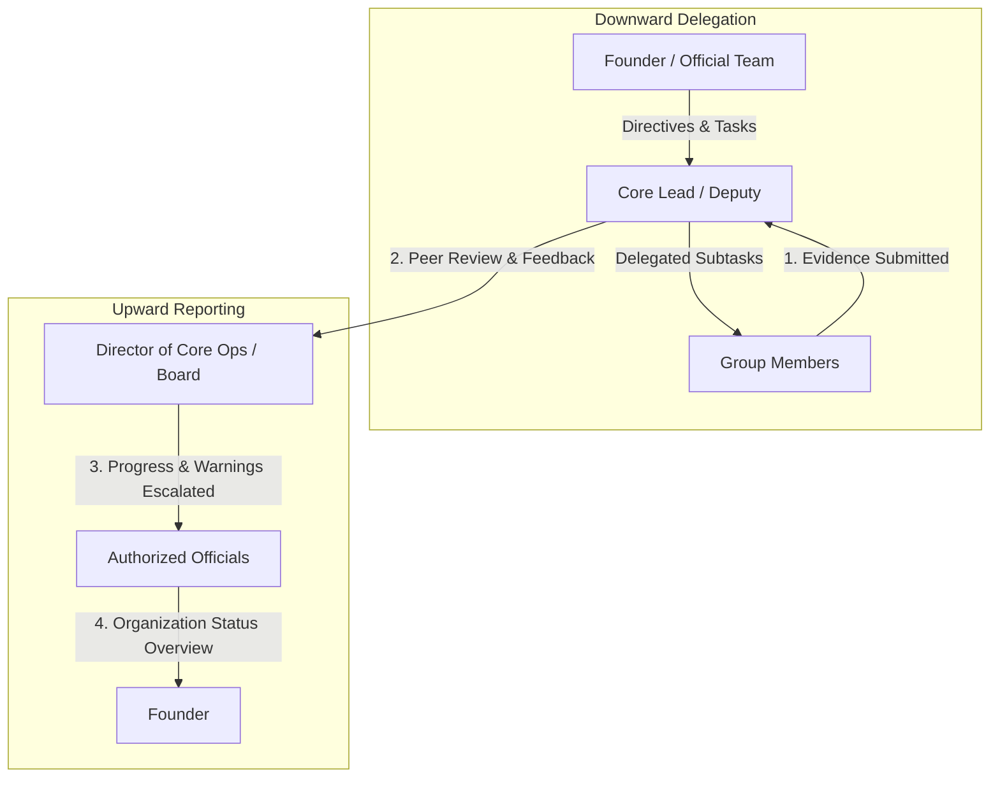

# TechNeekX Community Reporting & Task Management System

A role-based community task allocation, evidence submission, peer review, idempotent scoring, live leaderboard, announcements, and audit logging platform built with Django REST Framework, PostgreSQL, and a modern React 19 / TypeScript frontend.

---

## 🌟 System Overview & MVP Scope

TechNeekX Community Reporting System provides a transparent, auditable platform for managing structured deliverables across hierarchical community teams:

1. **Role-Based Identity & Security (SimpleJWT)**:
   - Full 12-role community hierarchy organized into 5 strict authorization tiers.
   - Public registration defaults safely to `Member` (Tier 5); privilege escalation attempts are strictly rejected.
   - Privileged sign-ups (Official, Core Lead, Director) stay `Pending` until approved in **Members & Roles**. Founder self-registration is disabled unless `FOUNDER_SETUP_KEY` is configured on the server.
   - Role changes follow the hierarchy: nobody edits their own role, and only the Founder may grant a role equal to or above their own.
   - JWT tokens (`access` and `refresh`) with silent automatic renewal on token expiry.
2. **Hierarchical Teams & Groups**:
   - Parent-team and sub-team relationships with specialized working groups.
   - Lead authorization required to assign or remove members.
3. **Structured Task Workflow State Machine**:
   - Explicit dual assignment: individual community member, entire team, or both (with membership validation).
   - Validated status transitions:
     - `Assigned` → `In Progress` → `Submitted` → `Approved` (completes task, awards the task's points).
     - `Submitted` → `Changes Requested` (requires mandatory feedback) → `Submitted` (corrected proof).
   - Arbitrary client-side status shifts and invalid state reversions are strictly rejected.
   - Each task carries a priority (`Low`/`Medium`/`High`/`Critical`) and a points value (1–100, default 10).
   - Assignees can post **progress notes** before submitting, so leads see work in flight.
4. **Verifiable Deliverable Proofs & Anti-Self-Review**:
   - Proof submissions support GitHub pull request URLs, screenshot links, and technical implementation notes.
   - **Anti-Self-Review Enforced**: Submitting members and assigned users are strictly forbidden from reviewing their own work (HTTP 403 Forbidden).
   - Only the assignee (or a member of the assigned group/team) can submit evidence; leaders cannot submit on someone's behalf.
5. **Transactional Idempotent Scoring**:
   - The task's points are awarded once to the submitter on approval.
   - The task row is locked and re-checked inside the review transaction, and a partial unique constraint allows at most one approved review per task, so concurrent reviewers get HTTP 409 instead of duplicate points.
6. **Live Community Leaderboard**:
   - Real-time performance standings sorted by points descending, completed task counts, and rank badges.
7. **Official Announcements & Immutable Audit History**:
   - Officials publish community bulletins; any other user can be granted the `can_post_announcements` permission from **Members & Roles**.
   - All state shifts, reviews, logins, and point grants are recorded in `history_logs`.

---

## 🏗️ Architecture & Repository Structure

```
TECHNEEKX REPORTING SYSTEM/
├── .env.example                               # Safe configuration template (committed)
├── .env                                       # Local environment settings (gitignored)
├── .gitignore                                 # Git protection for secrets, DBs, and builds
├── README.md                                  # Complete system documentation
├── database/
│   └── techneekx_reporting_schema_seed.sql    # Reviewed baseline PostgreSQL schema & seed data
├── docs/
│   ├── architecture.md                        # Architectural specification & RBAC rules
│   ├── audit_phase1.md                        # Initial codebase audit report
│   ├── database_integration.md                # PostgreSQL mapping & migration strategy
│   ├── frontend_foundation.md                 # UI design tokens & component system
│   └── frontend_api_integration.md            # Feature-to-endpoint mappings & workflows
├── backend/                                   # Django REST Framework Backend
│   ├── manage.py                              # Django management CLI
│   ├── requirements.txt                       # Python dependencies
│   ├── config/                                # Core project settings, URLs, and WSGI/ASGI
│   │   ├── settings.py                        # DB, JWT, CORS, and DRF configuration
│   │   └── urls.py                            # Root API route router
│   ├── apps/                                  # Modular domain applications
│   │   ├── accounts/                          # Custom User model, roles, JWT auth, and RBAC
│   │   ├── teams/                             # Teams, Groups, and membership management
│   │   ├── tasks/                             # Task CRUD, assignments, and lifecycle state machine
│   │   ├── submissions/                       # Proof evidence, reviews, and anti-self-review
│   │   ├── scoring/                           # Transactional points engine and live leaderboard
│   │   ├── announcements/                     # Community announcements API
│   │   └── activity/                          # Immutable audit logs and event tracker
│   └── tests/                                 # Automated Django unit and integration tests
└── frontend/                                  # React 19 + TypeScript + Vite Application
    ├── package.json                           # Node dependencies and scripts
    ├── vite.config.ts                         # Vite bundler configuration
    ├── scripts/
    │   └── test-frontend.mjs                  # Native integration test runner (Node 24)
    └── src/
        ├── types/api.ts                       # Typed TypeScript models and DTOs
        ├── services/api.ts                    # Axios/Fetch client with JWT auto-refresh
        ├── context/AuthContext.tsx            # Global auth state and demo persona switcher
        ├── styles/tokens.css                  # Black & red design tokens (WCAG AA in dark and light themes)
        ├── components/
        │   ├── ui/                            # 13 reusable accessible component primitives
        │   └── layout/                        # Sidebar, TopBar, and responsive AppShell
        └── views/                             # Dashboard, Tasks, Leaderboard, Teams, etc.
```

---

## ⚙️ Environment Configuration

Copy `.env.example` to create your local `.env`:
```powershell
Copy-Item .env.example .env
```

| Variable Name | Default / Example Value | Description |
| :--- | :--- | :--- |
| `SECRET_KEY` | `django-insecure-random-key` | Django cryptographic signing key |
| `DEBUG` | `True` (dev) / `False` (prod) | Debug error display mode |
| `ALLOWED_HOSTS` | `localhost,127.0.0.1` | Whitelisted HTTP host headers |
| `DB_NAME` | `techneekx_db` | PostgreSQL database name |
| `DB_USER` | `postgres` | PostgreSQL username |
| `DB_PASSWORD` | `your_postgres_password` | PostgreSQL password |
| `DB_HOST` | `localhost` | PostgreSQL host |
| `DB_PORT` | `5432` | PostgreSQL port |
| `JWT_ACCESS_TOKEN_LIFETIME_MINUTES` | `60` | JWT access token lifespan |
| `JWT_REFRESH_TOKEN_LIFETIME_DAYS` | `7` | JWT refresh token lifespan |
| `CORS_ALLOWED_ORIGINS` | `http://localhost:5173,http://127.0.0.1:5173` | Allowed frontend origins |
| `VITE_API_BASE_URL` | `http://127.0.0.1:8000/api` | Base URL for frontend API client |
| `USE_SQLITE` | `True` | Use the bundled SQLite database; set `False` for PostgreSQL |
| `FOUNDER_SETUP_KEY` | *(empty)* | Enables Founder self-registration when set; keep it long and random |
| `DIRECTOR_SETUP_KEY` | *(empty)* | Lets a Director registration activate immediately; otherwise it stays Pending |
| `VITE_TECHNEEKX_SITE_URL` / `VITE_FS_SITE_URL` | *(empty)* | External website links shown in the sidebar (hidden when empty) |

> [!CAUTION]
> Never commit actual passwords, private keys, or `.env` files to source control. `.env` is strictly protected in `.gitignore`.

---

## 🗄️ Database Architecture & Demo Persistence (Phase 11)

The system supports **dual database backends**:
1. **Lightweight Local SQLite (Default for Demo & Local Dev)**:
   - Configured via `USE_SQLITE=True` in `.env` (or environment variable).
   - Zero PostgreSQL installation blocker for evaluation and local testing.
   - Stores all accounts, tasks, groups, warnings, and announcements in persistent `backend/db.sqlite3`.
   - Data survives application restarts.
2. **Production-Ready PostgreSQL**:
   - Set `USE_SQLITE=False` in `.env` and specify `DB_NAME`, `DB_USER`, `DB_PASSWORD`, `DB_HOST`, `DB_PORT`.
   - All migrations, models, JSON fields, and transactions are 100% compatible with both SQLite and PostgreSQL.

### Initialize or Reset the Demo Database
Run the idempotent seed command to populate all 4 hierarchy levels, groups, sample tasks (including same-day and overdue), proofs, reviews, warnings, and announcements:

```powershell
# Populate demo database idempotently (safe to run multiple times)
python backend\manage.py seed_demo_data

# Safely reset development demo database from scratch (when explicitly requested)
python backend\manage.py seed_demo_data --reset
```

---

## 🚀 Running the System Locally

### Backend (Django REST Framework)
```powershell
# 1. Activate Python virtual environment
.\.venv\Scripts\Activate.ps1

# 2. Run database migrations
python backend\manage.py migrate

# 3. Seed demo data (if not already seeded)
python backend\manage.py seed_demo_data

# 4. Start backend server (listening on http://127.0.0.1:8000)
python backend\manage.py runserver 127.0.0.1:8000
```

### Frontend (React 19 + TypeScript + Vite)
```powershell
# 1. Install frontend dependencies
npm --prefix frontend install

# 2. Start Vite dev server (listening on http://127.0.0.1:5173)
npm --prefix frontend run dev
```

Open `http://localhost:5173/` in your browser.
Use the discreet **Persona Switcher** dropdown in the top header or the login tiles to test any role across the 4 hierarchy levels!

---

## 🧪 Running Automated Tests

### 1. Backend Django Test Suite (68 Tests)
Exercises authentication, registration privilege escalation prevention, permissions matrix, task lifecycle state machine, anti-self-review guards, idempotent scoring, and the security hardening regressions in `tests/test_security_hardening.py`:
```powershell
cd backend
python manage.py test tests
```
*Result: 68 passed (0 failures, 0 errors).*

### 2. Frontend Integration & Boundary Test Suite (20 Tests)
Exercises authentic JWT token retrieval, API security boundaries, correction-resubmission cycles, duplicate review prevention, leaderboard updates, and audit trail records against the live backend:
```powershell
npm --prefix frontend test
```
*Result: 20 passed (0 failures, 0 skipped).*

### 3. Frontend Static Analysis & Type Checking
```powershell
# Oxlint static analysis (0 errors)
npm --prefix frontend run lint

# TypeScript strict type-check & Vite production bundle build
npm --prefix frontend run build
```

---

## 🛡️ Official TechNeekX 4-Level Hierarchy & Permissions

| Level | Category | Roles | Scope & Responsibilities |
| :---: | :--- | :--- | :--- |
| **Level 1** | **Official Team** | `Founder`, `Chairman`, `Managing Director`, `President`, `CTO`, `Official` | Highest administrative authority. Organization-wide visibility, group creation & deletion, user role assignment, downward task creation & delegation, official announcements publishing. |
| **Level 2** | **Board** | `Director of Core Operations`, `Mentor` | Independent reporting monitor. Inspects overdue/missing reports across groups, issues compliance warnings (max 5 active), flags members for removal review. Does not delete groups or create arbitrary official tasks. |
| **Level 3** | **Core Team** | `Core Team Lead`, `Core Lead`, `Deputy` | Operational group leads. Associated with specific working groups. Receives parent tasks, delegates subtasks downward to group members, reviews deliverables, and reports group progress upward. |
| **Level 4** | **Members** | `Member` (TechNeekX Family 🎀) | Executes assigned tasks, submits GitHub pull requests and proof screenshots, views reviewer feedback, tracks personal points and leaderboard rank. |

---

## 🔄 Task Delegation & Upward Reporting Workflow



---

## 👥 Seed Demo Personas for Evaluation

All demo accounts use the standard demo password: `Techneekx@2026`

| Hierarchy Level | Category | Email | Name | Role Title | Key Capabilities |
| :---: | :--- | :--- | :--- | :--- | :--- |
| **Level 1** | Official Team | `founder@example.com` | Demo Founder | Founder | Organization-wide administration, group governance, user management |
| **Level 1** | Official Team | `cto@example.com` | Marcus CTO | CTO | Technical task directives, downward task delegation |
| **Level 1** | Official Team | `official@example.com` | Demo Official | Official | Organization reviews, cross-group auditing |
| **Level 2** | Board | `director.ops@example.com` | Anita Director | Director of Core Operations | Daily reporting monitoring, issue warnings (max 5 active), flag removal |
| **Level 2** | Board | `mentor.riya@example.com` | Riya Mentor | Mentor | Technical mentorship, review compliance tracking |
| **Level 3** | Core Team | `corelead.vikram@example.com` | Vikram Core Lead | Core Team Lead | Manage AI Group, delegate subtasks to Dev & Kavya, review work |
| **Level 3** | Core Team | `deputy.rohit@example.com` | Rohit Deputy | Deputy | Assist AI/Web groups, monitor group deadlines |
| **Level 4** | Members | `member.dev@example.com` | Dev Member | Member | AI Group member: view tasks, submit GitHub links & proof |
| **Level 4** | Members | `member.kavya@example.com` | Kavya Member | Member | AI Group member: submit deliverables, track leaderboard points |
