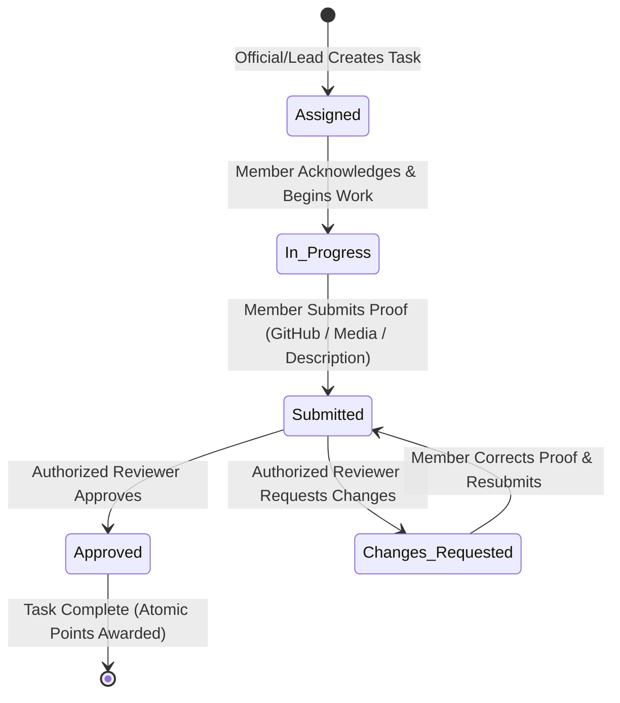

# TechNeekX Community Reporting & Task Management System
## Architecture & Technical Specification

### 1. Architectural Overview
TechNeekX Community Reporting System is structured as a decoupled client-server architecture:
- **Backend:** Python / Django / Django REST Framework (DRF) exposing RESTful JSON APIs.
- **Frontend:** React with TypeScript and Vite, styled using curated Vanilla CSS design tokens based on the project style guide.
- **Database:** PostgreSQL (v18.4) maintaining relational integrity with foreign keys, checks, indexes, and transactional boundaries.

```
+----------------------------------------------------------------+
|                        Client Layer                            |
|  React + TypeScript + Vite | Vanilla CSS Token Design System   |
|  Role Dashboards | Task Submission Queue | Review Interface    |
+-------------------------------+--------------------------------+
                                | (HTTPS / JWT Auth Bearer)
                                v
+----------------------------------------------------------------+
|                        API Gateway / DRF                       |
|  Authentication (JWT) | Permission Policies (RBAC)             |
|  Task Workflow Engine | Scoring & Leaderboard Service          |
+-------------------------------+--------------------------------+
                                |
                                v
+----------------------------------------------------------------+
|                   Database Layer (PostgreSQL)                  |
|  Roles | Teams | Groups | Users | Tasks | Task Proofs          |
|  Reviews | Performance | History Logs | Extra Material         |
+----------------------------------------------------------------+
```

---

### 2. Role Hierarchy & Access Matrix

The system models community hierarchy with strict authorization barriers:

1. **Founder:** Top-level authority with complete organizational access, audit log visibility, and team oversight.
2. **Official / Core Operations:** Manages organizational announcements, oversees all teams, audits task throughput, and resolves escalated reviews.
3. **Core Team Lead:** Manages tasks within assigned teams/groups, creates task assignments, reviews submissions, and requests changes.
4. **Group Leader / Deputy:** Assists in coordinating team tasks, mentors members, and can review assigned group tasks.
5. **Member:** Default role for public registration. Views assigned personal/team tasks, submits proofs (GitHub link, screenshot, description), resubmits rejected tasks, and tracks personal points/rank.

*Security Constraint:* Ordinary registration defaults strictly to `Member`. Elevation to higher tiers requires explicit administrative action.

---

### 3. Core Task Lifecycle Workflow



- **Assignment Logic:** A task can be assigned to an individual user (`assigned_to`), a specific team (`team_id`), or both.
- **Submission Rules:** At least one evidence field (`github_link`, `screenshots`, `description`) must be provided.
- **Review Rules:** 
  - Reviewer cannot be the submitter (no self-review).
  - Decision must be `Approved` or `Changes Requested`.
  - When approved, points are awarded to the submitter's performance record atomically.
  - Repeated approval requests do not duplicate point awards (idempotency check).

---

### 4. Database Schema Structure

Derived directly from `techneekx_reporting_schema_seed.sql`:

| Table Name | Primary Key | Key Foreign Keys & Attributes |
| :--- | :--- | :--- |
| `roles` | `role_id` | `name` (UNIQUE), `description` |
| `teams` | `team_id` | `name` (UNIQUE), `type`, `parent_team_id` (Self-referencing FK) |
| `groups` | `group_id` | `name`, `team_id` (FK -> teams) |
| `users` | `user_id` | `email` (UNIQUE), `role_id` (FK), `team_id` (FK), `status` (Active, Inactive, Pending) |
| `announcements` | `announcement_id` | `title`, `content`, `created_by` (FK -> users) |
| `tasks` | `task_id` | `title`, `created_by` (FK), `assigned_to` (FK), `team_id` (FK), `status`, `deadline` |
| `task_proofs` | `proof_id` | `task_id` (FK), `submitted_by` (FK), `github_link`, `screenshots`, `description` |
| `reviews` | `review_id` | `task_id` (FK), `proof_id` (FK), `reviewer_id` (FK), `decision`, `feedback` |
| `performance` | `performance_id` | `user_id` (FK), `points`, `rank`, `updated_at` |
| `history_logs` | `log_id` | `user_id` (FK), `action`, `details`, `created_at` |
| `extra_material` | `material_id` | `title`, `type`, `created_by` (FK), `file_url` |

---

### 5. UI/UX Style Token Standards

- **Primary Violet:** `#635BFF`
- **Primary Hover:** `#5145E5`
- **Secondary Indigo:** `#818CF8`
- **Accent Cyan:** `#22D3EE`
- **App Background:** `#F6F7FB`
- **Surface / Card:** `#FFFFFF`
- **Sidebar Background:** `#111827`
- **Main Text:** `#111827`
- **Secondary Text:** `#6B7280`
- **Borders:** `#E5E7EB`
- **Success:** `#16A34A`
- **Warning:** `#F59E0B`
- **Danger:** `#EF4444`
- **Info:** `#3B82F6`
- **Typography:** `Inter`, system-ui, -apple-system, sans-serif
